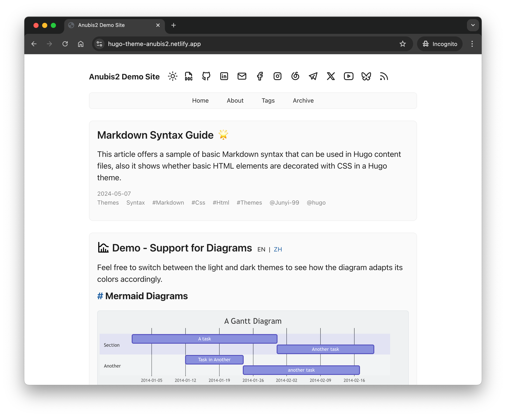
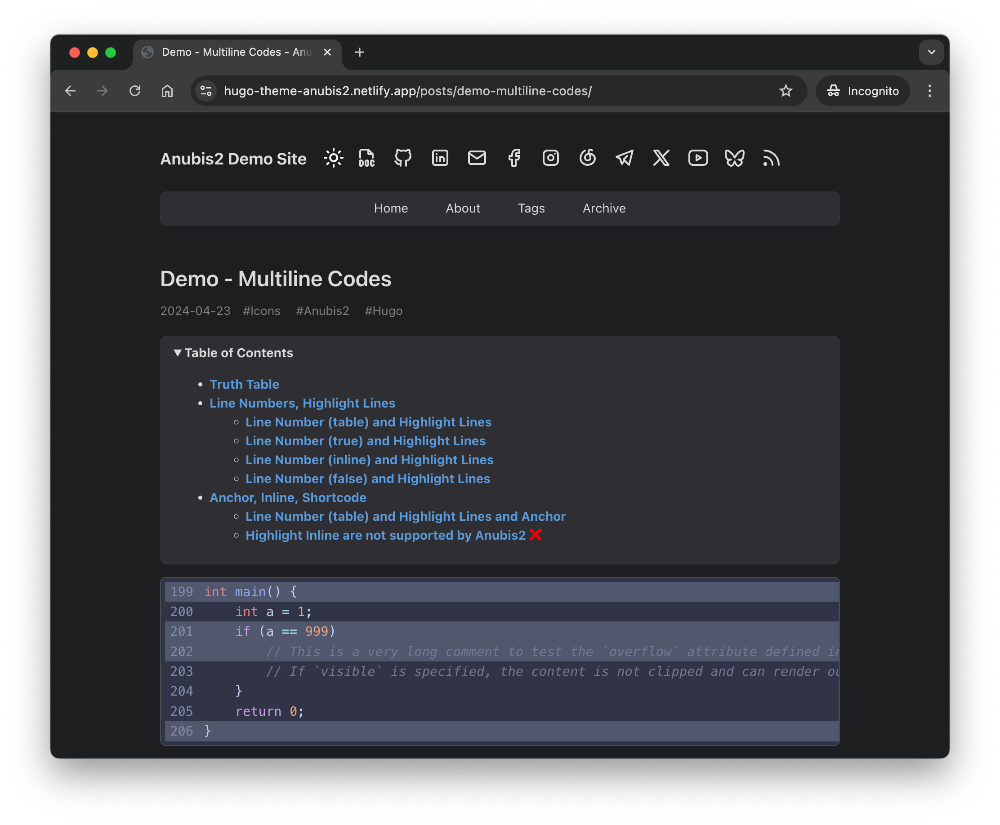
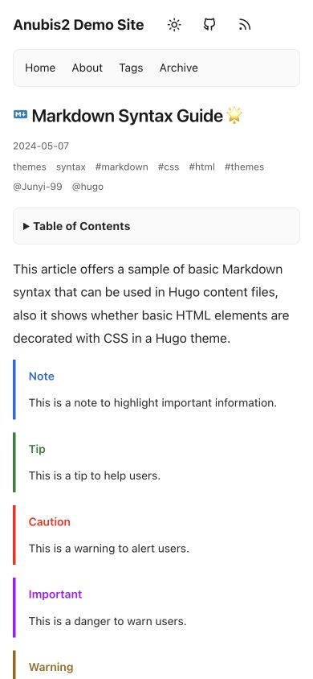

# Anubis2 for Hugo

[](LICENSE) [](https://app.netlify.com/sites/hugo-theme-anubis2/deploys)

A minimal Hugo theme for personal blogs and technical writing, with readable code, multilingual pages, and light and dark modes.

[Live demo](https://hugo-theme-anubis2.netlify.app/) · [Features](Features.md) · [Parameters](PARAMS.md) · [Full example configuration](example-site/hugo.full.toml)

| Light | Dark |
| --- | --- |
|  |  |

## Features

- Light, dark, and system-following color modes, with a manual switcher.
- Multilingual pages, language switching, and RSS feeds.
- Collapsible table of contents, syntax highlighting, code copying, Mermaid diagrams, and opt-in MathJax.
- Giscus, Disqus, and Utterances comments; Google Analytics and Umami integration.
- Mobile reading layouts: single-row scrollable navigation, responsive titles, and independently scrolling code blocks and wide tables.
- Figure captions, smaller muted footnotes, and subtle icons on article text links.

The mobile and article styling improvements are included in **v1.9.0**. See the [release notes](https://github.com/hugo-theme-anubis2/hugo-theme-anubis2/releases/tag/v1.9.0) for changes and upgrade guidance.



## Quick start

Install [Hugo](https://gohugo.io/installation/) and Git. The quick start and both example configurations have been verified with **Hugo extended 0.167.0**. This is a tested version, not a claimed minimum; older versions have not been validated as part of this update. The built-in styles use plain CSS. Additional Sass requirements are described below.

### Create a site and install the theme

```bash
hugo new site my-blog
cd my-blog
git init
git submodule add https://github.com/hugo-theme-anubis2/hugo-theme-anubis2.git themes/anubis2
```

For an existing Hugo site, run only the submodule command from the site root; initialize Git first if needed.

For a new site, replace the generated configuration with the minimal example:

```bash
cp themes/anubis2/example-site/hugo.minimal.toml hugo.toml
```

The minimal configuration is:

```toml
baseURL = "https://example.org/"
locale = "en-us"
title = "My Blog"
theme = "anubis2"

[pagination]
pagerSize = 5

[params.author]
name = "Your Name"

[params.anubis2]
colortheme = "auto"

[markup.goldmark.renderer]
unsafe = true # Render raw HTML such as figures in Markdown.
```

Set `baseURL` to your deployed site's address and replace the title and author. When adapting an existing site, merge the relevant settings instead of replacing your configuration.

### Create a post and preview it

```bash
hugo new content posts/hello-world.md
hugo server -D
```

Add Markdown below the front matter in `content/posts/hello-world.md`, then open [localhost:1313](http://localhost:1313/). New posts are drafts; `-D` includes them in the preview. Set `draft = false` in TOML front matter (or `draft: false` in YAML) when the post is ready to publish, then run `hugo` to build the site into `public/`.

When cloning a site that already uses this theme, initialize its submodules before building:

```bash
git submodule update --init --recursive
```

## Common configuration

Theme settings belong under `params.anubis2`. These docs use lowercase parameter keys consistently. Hugo normalizes keys in `params`, so existing camelCase settings such as `colorTheme` and `repoId` also work; they do not need a case-only migration.

For navigation, add menu entries to `hugo.toml`. A menu item links to a page; it does not create that page.

```toml
[[menu.main]]
name = "Home"
url = "/"
weight = 1

[[menu.main]]
name = "Archive"
url = "/posts/"
weight = 2
```

Add social links to your existing `[params.anubis2]` table:

```toml
socialicons = [
  { id = "github", url = "https://github.com/your-name" },
  { id = "email", url = "mailto:you@example.org" }
]
```

See [PARAMS.md](PARAMS.md) for defaults, per-page options, and service configuration. The [full example](example-site/hugo.full.toml) also demonstrates language-specific menus. Its comments and analytics use demo accounts: replace those service tables with your own settings, or remove them.

## Custom styles

Create `assets/css/custom.css` in your site and add the following to your existing `[params.anubis2]` table:

```toml
customcss = ["css/custom.css"]
```

Paths are relative to `assets/`. Custom CSS loads after the theme styles, so you can override them without editing the theme submodule. For example, to remove the decorative article link icons:

```css
article.post .content a[href]::after {
  content: none !important;
}
```

### Optional Sass/SCSS

Plain CSS needs no Sass compiler. For custom `.scss` or `.sass` assets, install [Dart Sass](https://gohugo.io/functions/css/sass/#dart-sass) on both your development and build hosts, and add these settings to `[params.anubis2]`:

```toml
csstranspiler = "dartsass"
customcss = ["css/custom.scss"]
```

The theme's compatibility default is `libsass`, which requires Hugo extended. Hugo deprecated LibSass in v0.153.0; use Dart Sass for new Sass customizations. The full example keeps its Sass demonstration commented out so it can build without an additional compiler.

## Updating

From your site's root, update only this theme:

```bash
git submodule update --remote themes/anubis2
hugo
```

Review the site locally with `hugo server -D`. Once satisfied, commit the updated theme reference so deployments use the same revision:

```bash
git add themes/anubis2
git commit -m "chore: update Anubis2 theme"
```

This follows the submodule's configured branch, or the remote's default branch when none is configured. To keep builds reproducible, commit the reference rather than running `--remote` during every deployment.

## Troubleshooting and migration

- **New post missing:** preview with `hugo server -D`, or set `draft = false` (TOML) / `draft: false` (YAML) for publication. Future-dated posts need `--buildFuture` when previewing.
- **Theme not found after cloning:** run `git submodule update --init --recursive`.
- **Deprecated top-level theme parameters:** move settings such as `params.colorTheme` into `params.anubis2`. Consult [PARAMS.md](PARAMS.md) for renamed options; capitalization alone is not the migration issue.
- **LibSass warning:** use plain CSS, or install Dart Sass and set `csstranspiler = "dartsass"`.
- **Raw HTML omitted:** enable `[markup.goldmark.renderer] unsafe = true` if you want raw HTML in your Markdown, including HTML figures. Both example configurations enable this setting.
- **Math not rendered:** set `math: true` in the page front matter, or enable `enablemathglobally` under `params.anubis2`.
- **Analytics absent in local preview:** analytics are injected only in production builds. Use `hugo --environment production` to inspect that output.

## Contributing

Report bugs and feature requests in [Issues](https://github.com/hugo-theme-anubis2/hugo-theme-anubis2/issues), or open a pull request. For rendering issues, include your Hugo version, relevant configuration, and a small content example.

To preview the example site from a theme checkout, run the full example configuration (the minimal example also builds, with fewer features enabled):

```bash
hugo server --source example-site --config hugo.full.toml --themesDir ../.. --theme "$(basename "$PWD")" -D
```

To build instead of serving, use `hugo` in place of `hugo server`. To check the minimal configuration, replace `hugo.full.toml` with `hugo.minimal.toml`.

## License

[MIT](LICENSE) © Junyi, 2024.
